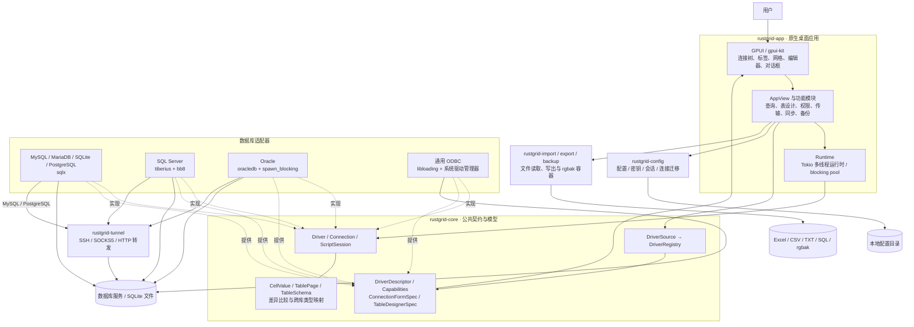
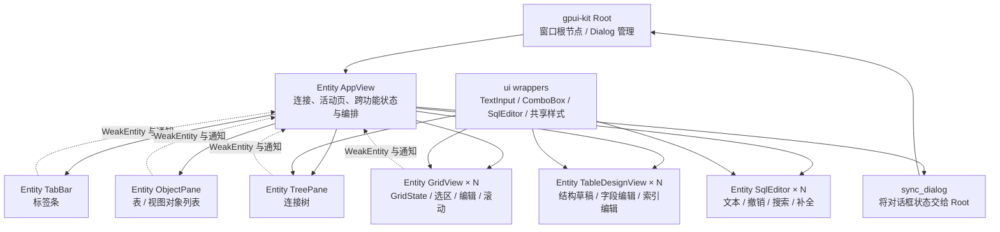
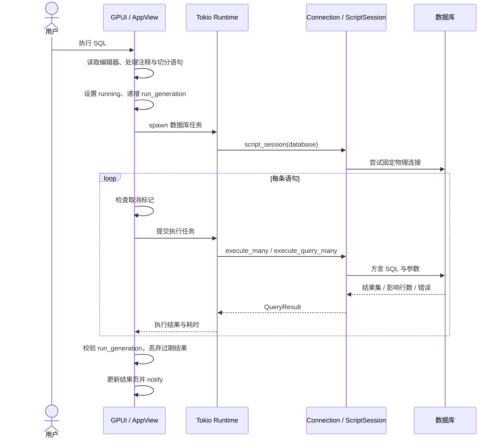
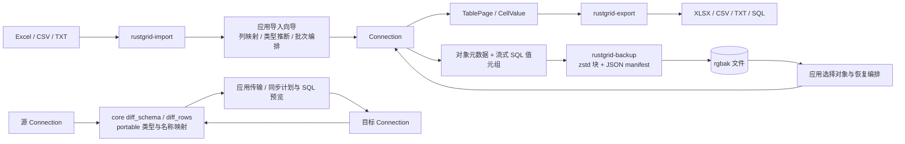

# RustGrid 架构分析与设计图

本文基于当前工作区的 Cargo 清单与源码静态分析，描述已经实现的结构。图中的逻辑分层不表示每层都有独立 crate；改进建议另行列出。未运行应用或连接数据库验证运行效果。

## 1. 架构定位

RustGrid 是跨平台原生数据库管理客户端，采用 **Cargo workspace 模块化单体 + 驱动适配器 + 元数据驱动 UI**。当前有 13 个 workspace crate，最终组合为一个 `RustGrid` 桌面程序，没有独立后端服务。

核心设计围绕三个边界展开：

- **数据库边界**：`Driver`、`Connection`、`ScriptSession` 隔离数据库协议、连接池、目录查询和 SQL 方言。
- **交互边界**：GPUI Entity 保存交互状态，`Runtime` 将数据库任务交给 Tokio，再通过 GPUI 上下文更新视图。
- **存储边界**：配置、导入、导出、备份分别封装为库；应用层组合这些库与数据库接口完成用户操作。

### 总体架构图

实线表示主要调用或数据流；虚线表示接口实现或规格提供关系。这不是完整的 Cargo 依赖图。

## 2. crate 划分与真实依赖

以下名称省略公共前缀 `rustgrid-`。

| crate | 责任 | 工作区内直接依赖 |
|---|---|---|
| `core` | 公共接口、配置与数据模型、能力规格、方言标识、结构/数据差异和类型映射 | 无 |
| `app` | 启动装配、原生 UI、任务编排、编辑器、会话恢复、更新 | core、config、backup、export、import、六个驱动 crate；odbc 可选 |
| `mysql` | MySQL / MariaDB 协议、目录、DML/DDL、权限、备份 | core、tunnel |
| `sqlite` | 文件数据库连接与操作 | core |
| `postgresql` | PostgreSQL 连接池、schema、强类型读写、对象管理 | core、tunnel |
| `sqlserver` | TDS、连接池、SQL Server 对象与权限模型 | core、tunnel |
| `oracle` | Oracle thin driver、同步调用隔离、schema / PL/SQL | core、tunnel |
| `odbc` | 动态加载驱动管理器，通用目录查询、SQL、分页及部分编辑操作 | core |
| `tunnel` | 网络驱动复用的分层代理与本地端口转发 | core |
| `config` | 配置版本化、密文密码、工作区会话、连接导入导出 | core |
| `import` | Excel / CSV / TXT 读取、编码处理、列类型推断 | core |
| `export` | XLSX / CSV / SQL / TXT 数据写出 | core |
| `backup` | `.rgbak` 格式、清单、分块压缩与读写 | core |

`core` 的第三方依赖仅为 `async-trait`、`serde`、`thiserror`，没有 GPUI、sqlx 或平台依赖。驱动之间没有直接依赖，文件库也没有依赖具体驱动。`app` 直接依赖各驱动，是因为 `main.rs::builtin_registry` 在启动时完成装配；日常操作通过 trait 对象调用。

根目录统一管理大部分依赖版本和 release profile，`vendor/sqlx-mysql` 通过 Cargo patch 提供 MySQL 兼容修复，不属于 workspace 成员。当前 `app` 的 Unix `libc` 依赖仍直接声明在成员清单中，是统一版本约定的一处例外。

## 3. 核心抽象与可扩展性

### Driver：引擎入口

`Driver` 提供引擎身份、默认连接值、SQL 方言、能力与编辑器规格，并通过 `connect(ConnectionConfig)` 返回 `Box<dyn Connection>`。应用连接成功后转换为 `Arc<dyn Connection>`，由各操作共享。

### Connection：数据库操作端口

`Connection` 覆盖目录查询、分页、增删改、任意 SQL、数据库与表结构、用户权限、视图、例程、备份恢复等操作。应用传递 `PageRequest`、`RowInsert`、`RowUpdate`、`TableSchema` 等公共模型，驱动负责标识符引用、绑定参数、类型转换与方言 SQL。

`ScriptSession` 单独表示脚本执行期间固定占用的物理连接，使事务、临时对象和会话变量在连续语句间保持有效。接口允许驱动不提供固定会话，此时查询流程会回退到连接对象执行，不能据此假定所有驱动都具备相同的脚本会话保证。

### Descriptor：驱动声明 UI 差异

`DriverDescriptor` 携带能力、图标、连接表单、数据库编辑规格和表设计规格；用户编辑规格也由驱动提供。

- `ConnectionFormSpec` 声明网络/文件/ODBC 首页、页面顺序、字段类型与条件可见性。
- `TableDesignerSpec` 声明字段列、设计子页、索引选项、自增约束与默认值建议。
- `DriverCapabilities` 决定不同功能的显示和可用性。
- 引擎扩展参数经 `ConnectionProfile.options` 保存，避免每加一个参数就修改公共配置结构。

这让遵守现有契约的新引擎可以复用主要 UI。若新引擎引入现有规格无法表达的概念，仍需扩展 core 契约与通用渲染器。

**扩展现状**：`DriverSource` 已是来源边界，但当前只注册 `BuiltinDriverSource`。尚无运行时插件发现、安装、版本协商或稳定动态库 ABI；ODBC 的动态加载指的是系统驱动管理器加载，不等同于 RustGrid 自身的驱动插件系统。

另外，“应用完全没有方言知识”尚不是事实：`src/sql.rs`、`app/sql_lex.rs` 仍包含方言判断、SQL 编辑辅助、注释规则与 MySQL 脚本切分；`core` 的 `portable`、`sync` 也含跨引擎映射和 SQL 渲染。这些应视为明确维护的方言边界。

## 4. UI 与状态架构

这是 **Entity 驱动的状态与视图组合**。`app/*.rs` 按功能拆分，但很多模块仍是同一个 `AppView` 的 `impl`，文件拆分并不等于状态隔离。`session.rs` 定义 `ConnectionNode`、`DatabaseNode`、`QueryTab`、`GridState` 等运行态模型；持久化会话 DTO 则定义在 `config`。

重要机制：

- `Loadable<T>` 区分未加载、加载中、成功和失败，支持目录懒加载。
- `ConnectionStatus` 表达连接生命周期，已连接态保存共享 trait 对象。
- 独立 Entity 和 `notify_*` 缩小重绘范围，网格拥有自己的编辑与交互状态。
- `ui::TextInput`、`ComboBox` 包装第三方控件，首次 render 才构造需要 `Window` 的内部状态。
- `keymap::Command` 统一快捷键、设置持久化与可重绑定行为。
- 用户文案通过 `rust-i18n` 的中英文 locale 管理，主题和嵌入资产单独组织。

## 5. 线程模型与查询时序

GPUI 管交互和绘制，`Runtime` 封装独立的 Tokio 多线程运行时。`cx.spawn` 配合 `Runtime::spawn` 等待后台任务，再通过 Entity update 修改 UI 状态。文件解析等同步任务可以走 `Runtime::spawn_blocking`；Oracle 驱动内部也明确使用 blocking pool 包装同步 API。

查询的取消标记与 generation 解决两个不同问题：前者让执行循环停止继续提交，后者阻止旧执行结果覆盖新状态。当前查询循环中检查取消标记，不能将此直接理解为数据库服务器已经中断正在运行的 SQL。

各驱动的连接策略：

| 引擎 | 实现与连接策略 | 关键差异 |
|---|---|---|
| MySQL / MariaDB | sqlx MySQL；共享协议实现 | `Engine` 承载两者少量方言差异 |
| SQLite | sqlx SQLite；数据库文件 | 无网络隧道；功能能力与服务器引擎不同 |
| PostgreSQL | 按数据库懒建 PgPool | 默认库常驻；额外池最多 2 连接、60 秒 idle；池表达到 16 时执行淘汰逻辑 |
| SQL Server | tiberius + bb8 | 每次操作借出 client；DDL batch 与参数化 RPC 分工 |
| Oracle | `Arc<oracledb::Pool>` + `spawn_blocking` | 单池服务 service/PDB 下的可见 schema |
| ODBC | libloading、系统驱动管理器、Mutex 保护句柄 | 同步 FFI；当前 `execute_query` 的 async 方法内直接调用同步 `run` |

ODBC 是通用补充入口，功能不完全等同于原生驱动。源码已实现部分增删改和表操作，但备份恢复、表设计器等路径仍返回不支持。

## 6. 数据与文件流

这里有两个重要区别：

1. **导出与备份不是同一条数据管道。** 导出以解码后的通用值写出多种格式；`.rgbak` 的数据块保存驱动生成的 SQL 值元组，manifest 含对象 DDL，因此不能把 `.rgbak` 直接视为跨引擎中立的数据交换格式。
2. **同步算法与同步编排分离。** core 计算结构/行差异和跨库类型映射，`app/sync.rs` 负责选择源目标、分页获取、计划、预览、执行与进度交互。目前没有独立的同步服务 crate。

`.rgbak` 采用顺序写入压缩块、末尾追加 JSON manifest 并回填偏移的布局，支持按对象选择性读取。该设计降低全量缓冲需求；它不意味着每种导入、查询和同步操作都实现了恒定内存处理。

## 7. 配置、部署与横切能力

`ConfigStore` 统一定位 OS 配置目录并管理版本迁移：

- `connections.json`：连接 profile；不保存明文密码。
- `settings.json`：语言、主题、快捷键与其他用户设置。
- `secrets.json` + `secret.key`：按 profile id 存储 XChaCha20-Poly1305 密文与本地密钥文件。
- `session.json`：打开的连接、查询、表和活动位置；启动后结合连接状态延迟恢复。
- `backups.json`、`transfers.json`：可复用任务配置。
- `queries/`：保存的 SQL 文件；另有旧 `queries.json` 迁移路径。
- `transfer` 模块：`.rgc`、Navicat `.ncx`、DBX JSON 统一转换为连接传输模型。

加密秘密存储是本地文件方案，不能等同于操作系统钥匙串或独立密钥服务。

启动时 `main.rs` 完成单实例控制、日志、驱动注册、配置加载、Tokio 创建、国际化和窗口初始化。`gpui-kit Root` 是窗口根节点。Windows resize、macOS Dock 图标及应用初始化差异通过平台条件编译隔离。

发布方面，仓库存在 `.github/workflows/release.yml`，处理 tag 版本校验、跨平台构建与归档；应用 `update.rs` 对接 GitHub Releases 更新。因此 AGENTS 中“没有 CI”的描述不应作为当前仓库状态的完整结论。现有工作流主要是发布构建，也不宜据此假设已有完整的持续测试流水线。

## 8. 架构评价与演进顺序

### 已有优势

1. **依赖方向稳定**：通用契约不依赖 UI 或数据库 SDK，各驱动和文件库独立可测。
2. **扩展机制覆盖交互差异**：表单、能力与设计器规格比单纯封装连接接口更完整。
3. **连接语义受到重视**：固定脚本连接、PostgreSQL 分库池和 Oracle 阻塞隔离都反映了引擎实际约束。
4. **文件能力具备独立边界**：配置、导入、导出和备份可以分别演进。

### 主要压力与建议

| 优先级 | 当前证据 / 压力 | 建议 |
|---|---|---|
| 高 | `AppView` 集中大量窗口、任务与业务状态；`user_create.rs`、`sync.rs`、`backup.rs` 等已有数千行 | 优先抽出查询执行、同步、备份等用例服务；由 UI 传入请求，接收进度与结果，避免服务依赖 GPUI |
| 高 | ODBC 的 async 查询路径直接执行同步 FFI | 建立独立 blocking 执行边界，长任务避免占用 Tokio 异步 worker；同时明确取消和超时语义 |
| 中 | `Connection` 同时承担查询、DDL、账户、权限、例程、备份等大量职责 | 随需求拆分可选能力端口，保留统一连接入口，逐步降低新驱动的实现负担 |
| 中 | 能力标志、旧 `supports_*` 方法、默认 MySQL 规格和不支持方法并存 | 建立每个驱动的契约测试，校验声明能力、可见控件与实际操作支持一致 |
| 中 | 编辑器、应用辅助和 core 中都存在方言逻辑 | 明确“编辑分析”与“执行方言”的接口归属，共享必要扫描结果，并覆盖引号、注释、PL/SQL、DELIMITER 等边界 |
| 中 | `DriverSource` 只有内置实现 | 真正需要运行时安装时，再设计清单、版本协商、能力检查和稳定边界；不能直接把 Rust trait 对象当稳定动态库 ABI |

建议先改善任务执行与状态边界，再考虑动态插件。当前更有价值的投入是让查询、同步和备份编排能够脱离窗口生命周期单独测试，同时保持已有驱动契约和通用 UI 规格。

## 9. 关键源码入口

- 工作区与装配：`Cargo.toml`、`crates/rustgrid-app/src/main.rs`
- 核心端口：`crates/rustgrid-core/src/driver.rs`、`registry.rs`
- 能力与界面规格：`crates/rustgrid-core/src/capability.rs`、`descriptor.rs`
- 通用模型与同步：`crates/rustgrid-core/src/model.rs`、`sync.rs`、`portable.rs`
- 应用状态与运行时：`crates/rustgrid-app/src/app/mod.rs`、`src/session.rs`、`src/runtime.rs`
- 查询与网格提交：`crates/rustgrid-app/src/app/query.rs`、`grid_commit.rs`
- 设计与同步：`crates/rustgrid-app/src/app/design.rs`、`sync.rs`
- SQL 编辑辅助：`crates/rustgrid-app/src/sql.rs`、`src/app/sql_lex.rs`、`sql_completion.rs`
- 配置与秘密：`crates/rustgrid-config/src/lib.rs`、`secrets.rs`
- 文件与发布：三个文件 crate 的 `src/lib.rs`、`.github/workflows/release.yml`
